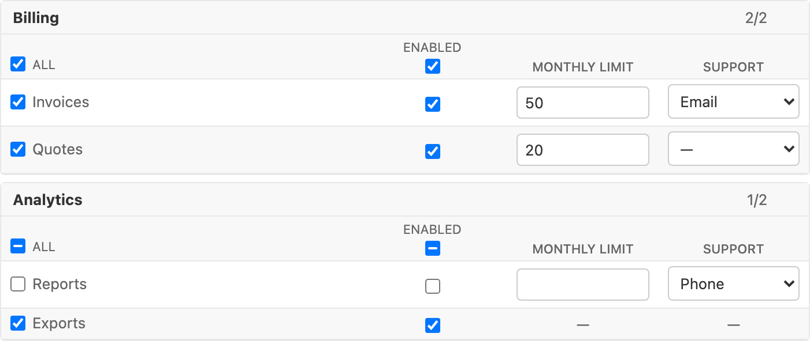
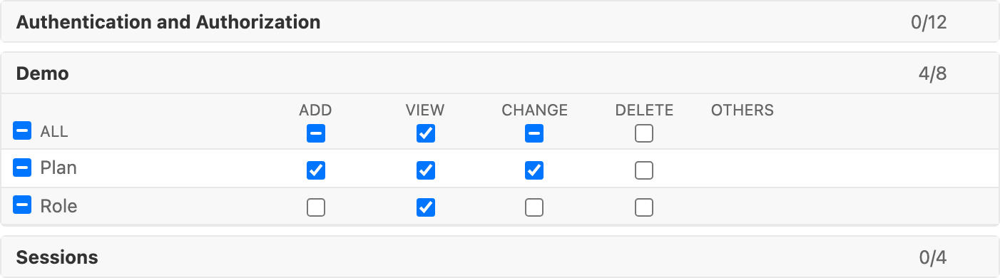

# django-form-matrix

[](https://github.com/rodolvbg/django-form-matrix/actions/workflows/pytest.yml)
[](https://pypi.org/project/django-form-matrix/)
[](https://pypi.org/project/django-form-matrix/)
[](https://pypi.org/project/django-form-matrix/)
[](https://pepy.tech/project/django-form-matrix)

A Django form field to fill a **table**: one row per item, one column per property and, in every cell, a form field of its own — a checkbox, a number, a choice, text. Rows can be grouped in collapsible sections, and checkbox columns get shortcuts to check a row, a column or a whole section.

It works in any Django form and in the admin. A ready-made **permission matrix** (apps → models → add/view/change/delete) is included as a use case.



## Installation

```bash
pip install django-form-matrix
```

Add `django_form_matrix` to `INSTALLED_APPS` (it ships a template, a script and a stylesheet):

```python
INSTALLED_APPS = [
    # ...
    "django_form_matrix",
]
```

## Quick start

```python
from django import forms
from django_form_matrix import Column, MatrixField, Row


class PlanForm(forms.Form):
    features = MatrixField(
        rows=[
            Row("invoices", "Invoices", section="Billing"),
            Row("quotes", "Quotes", section="Billing"),
            Row("exports", "Exports", section="Analytics", columns=["enabled"]),
        ],
        columns=[
            Column("enabled", "Enabled"),  # a checkbox unless said otherwise
            Column("limit", "Monthly limit", forms.IntegerField(min_value=0, required=False)),
        ],
    )
```

Render the form as usual and add `{{ form.media }}` (the admin does it for you). The cleaned value has one entry per row with the cells that exist:

```python
form.cleaned_data["features"]
# {"invoices": {"enabled": True, "limit": 50},
#  "quotes": {"enabled": False, "limit": None},
#  "exports": {"enabled": False}}
```

That is what a `JSONField` stores, so a `ModelForm` can save it directly.

### Rows and columns

- `Column(key, label, field=BooleanField(required=False))`: the form field of the column. Its validation and its widget are Django's own, and a failing cell is reported with its row and column ("Invoices, Monthly limit: …").
- `Row(key, label, section=None, columns=None)`: `section` groups rows under a collapsible heading (rows without one go in a plain table); `columns` are the keys of the columns that have a cell in this row, the rest show a dash.
- `MatrixField(rows=…, columns=…)` is not required by default; with `required=True` at least one cell needs a value. `rows` and `columns` can be reassigned in a form's `__init__` to build the matrix dynamically.

Each cell is submitted as `<name>__<row key>__<column key>`, so it reads like any other widget.

### Shortcuts

Checkbox columns get a checkbox in their heading, every row with checkboxes gets one at its start, and each section gets an "All". They show whether their cells are all, some or none checked, and the heading of a section counts the checked ones. A section opens by itself when something in it is filled.

## Permissions

```python
from django_form_matrix.contrib.permissions import PermissionMultipleChoiceField

class RoleAdmin(admin.ModelAdmin):
    def formfield_for_manytomany(self, db_field, request, **kwargs):
        if db_field.name == "permissions":
            kwargs["form_class"] = PermissionMultipleChoiceField
        return super().formfield_for_manytomany(db_field, request, **kwargs)
```



One section per app, one row per model and a column per action; the other permissions of a model go in an "Others" column. It submits like a `CheckboxSelectMultiple`, so validation and saving do not change, and the names of the permissions are shown translated. Needs `django.contrib.auth`.

## Styling

The stylesheet uses the colours of the Django admin when it is there. Anywhere else, set `--form-matrix-border`, `--form-matrix-heading-bg` and `--form-matrix-quiet` on `.form-matrix`.

## Development

```bash
uv sync && npm install
uv run pytest            # Python + end-to-end (needs `uv run playwright install chromium`)
npm test                 # JS
cd example && uv run python manage.py runserver   # demo: Plans and Roles in the admin
```
